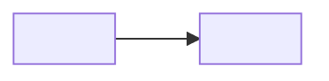
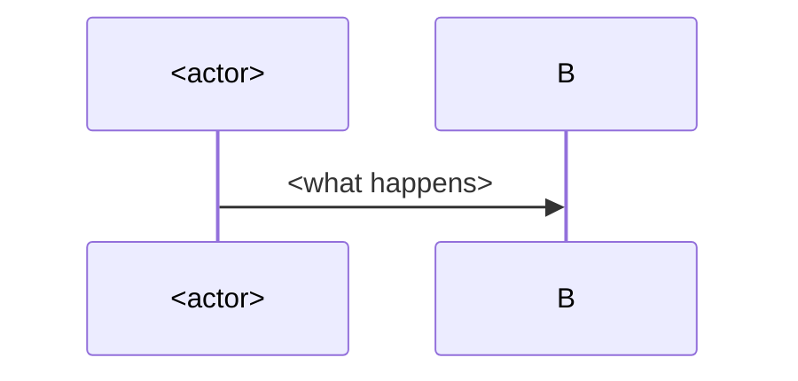

# Code map: <project>

<First sentence that stands alone: what this code is and what this map is for. `scripts/map.py --check` watches the `modules` list above and reports the page stale when a module gets a commit after `last_mapped`.>

## Visão geral

<One mermaid diagram of the whole: the big parts and who calls whom. Keep it under ~15 nodes.>

## Estrutura

<The tree of top-level folders, one line each: `<pasta>/` — what lives there. Take the folders and sizes from `map.py`'s `por_pasta`.>

## Módulos

<One section per module in `modules` — this is what `--check` watches.>

### <pasta-de-topo>

<What it does, its key files, its entry points and what it talks to. Names of things only: variables, functions, files — never values, secrets or personal data.>

## Fluxos

<The paths that matter, one `sequenceDiagram` each: a request coming in, a job running, a deploy.>

## Convenções

<The rules the code follows: naming, layout, errors, tests. What a new file must do to fit.>

## Armadilhas

<What bites: outdated docs, hidden coupling, the file everyone edits wrong. One bullet each, with the file path.>

## Onde mexer para…

<"To change X, touch Y": a short lookup table from intent to files.>

- **<intent>**: <files>

## History

- YYYY-MM-DD: <a change that alters what this page claims, and why (PR/issue)>

---

Map: [index](index.md) · Related: [a](a.md) · [b](b.md)
